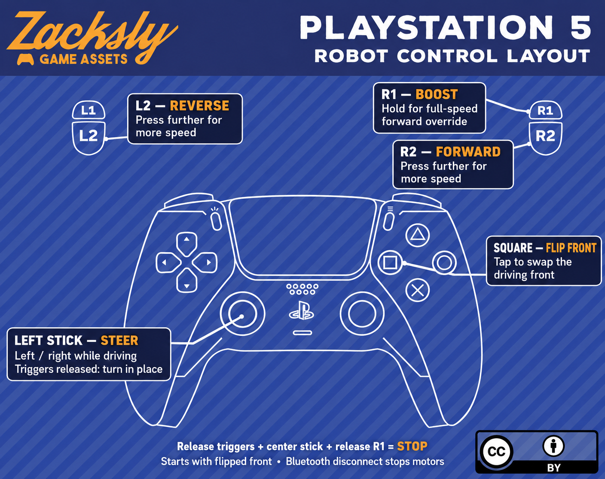

# PS5-Controlled ESP32 Robot

Control a two-motor robot with a PS5 DualSense controller over Bluetooth. The ESP32 drives an L298N motor driver with proportional throttle, steering, pivot turns, and a button to swap the robot's front.

Controller artwork attribution: [Zacksly Game Assets](docs/images/ATTRIBUTION.md).

## Hardware

- ESP32 board with Bluetooth Classic support
- PS5 DualSense controller
- L298N motor driver
- Two DC motors, chassis, and a suitable motor battery
- Jumper wires and a suitable power supply for the ESP32

### Wiring

| ESP32 GPIO | L298N connection | Purpose |
| --- | --- | --- |
| 25 | ENA | Left motor PWM |
| 26 | IN1 | Left motor direction |
| 27 | IN2 | Left motor direction |
| 32 | ENB | Right motor PWM |
| 33 | IN3 | Right motor direction |
| 14 | IN4 | Right motor direction |
| GND | GND | Common ground |

Connect the left motor to OUT1/OUT2 and the right motor to OUT3/OUT4. Remove the ENA/ENB jumpers so the ESP32 can control speed. Power the motors through the driver's motor supply and connect the ESP32, driver, and battery grounds together. Use a power supply appropriate for your ESP32 board; do not connect the motor battery directly to its 3.3 V pin.

## Setup

1. Install Arduino IDE, the ESP32 board package, and a library that provides `ps5Controller.h` and the `ps5` API used by this sketch.
2. Use an ESP32 board package compatible with `ledcSetup()` and `ledcAttachPin()`. The sketch uses the older LEDC API; newer packages may require adapting the PWM setup.
3. Open [`ps5_motor1.ino`](ps5_motor1.ino). Keep [`drive_control.h`](drive_control.h) in the same sketch folder.
4. Set `PS5_MAC` in the sketch to the Bluetooth address required by your controller library's pairing procedure, and pair the DualSense according to that library's instructions.
5. Select your ESP32 board and serial port, then upload the sketch.
6. Open Serial Monitor at **115200 baud** and connect the controller. Connection status, selected orientation, and motor commands are logged there.

For the first run, raise the wheels clear of the ground and verify motor direction and stopping behavior.

## Controls

| Input | Action |
| --- | --- |
| R2 | Proportional forward throttle |
| L2 | Proportional reverse throttle; R2 takes priority when both are pressed |
| Left stick X | Steer while driving; pivot in place with both triggers released |
| R1 | Full-speed forward override, ignoring trigger and steering inputs |
| Square | Toggle which end of the robot is the front |
| Release R1 and both triggers, center left stick | Stop |

The robot starts with its front **inverted** relative to the original motor orientation. Square reverses travel and swaps wheel roles so steering stays relative to the selected front. Left stick Y is unused.

See the [control guide](docs/CONTROLS.md) for the annotated diagram and additional details.

## Drive behavior

- PWM: **1 kHz**, **8-bit**, with motor commands from **-255 to 255**.
- Trigger deadzone: **10**; horizontal stick deadzone: **14**.
- Throttle follows input directly, without timed acceleration ramps.
- When Bluetooth reports a disconnection, the motors stop.
- A direction reversal disables both motor bridges for **20 ms** before applying the new command.
- After reconnecting, Square must be released before a press can toggle orientation.

## Files

| File | Purpose |
| --- | --- |
| [`ps5_motor1.ino`](ps5_motor1.ino) | Bluetooth connection, GPIO/PWM setup, and motor output |
| [`drive_control.h`](drive_control.h) | Throttle, steering, and orientation mixing |
| [`docs/CONTROLS.md`](docs/CONTROLS.md) | Controller reference |

## Troubleshooting

- **Controller will not connect:** verify Bluetooth Classic support, the installed controller library, and its pairing/address procedure.
- **PWM functions fail to compile:** select an ESP32 package compatible with the LEDC API used here, or port the setup to your installed package's API.
- **Motors do not move:** check motor power, common ground, ENA/ENB jumper removal, and the wiring table.
- **A wheel runs in the wrong direction:** verify the left/right motor assignments and swap that motor's output leads if needed.
