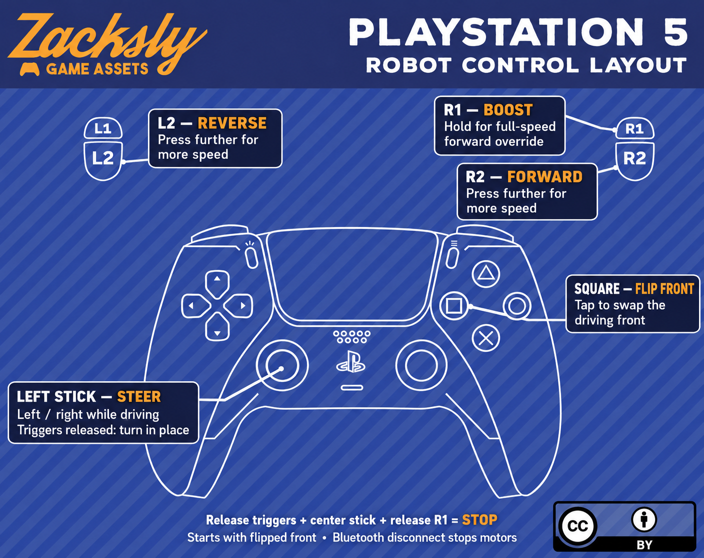

# PS5 robot controls



Outline artwork adapted from Zacksly Game Assets; see [attribution](images/ATTRIBUTION.md).

- **R2:** proportional forward speed.
- **L2:** proportional reverse speed. R2 takes priority if both triggers are pressed.
- **Left stick X:** proportional steering while driving; pivot turning when both triggers are released. Stick Y is unused.
- **R1:** full-speed forward override; overrides trigger and steering inputs while held.
- **Square:** toggle which end of the robot is treated as the front. Starts flipped.
- **Stop:** release R1 and both triggers, then center the left stick. Bluetooth disconnection also stops the motors.

PWM is 1 kHz, 8-bit (0–255). The PS5 sketch follows trigger input directly; it does not implement timed acceleration ramps.

To embed the diagram in a root README:

```markdown

```
